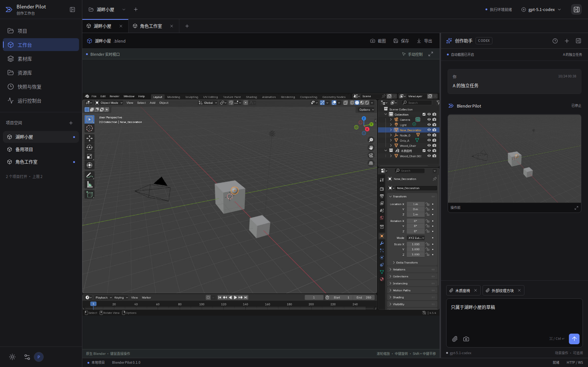
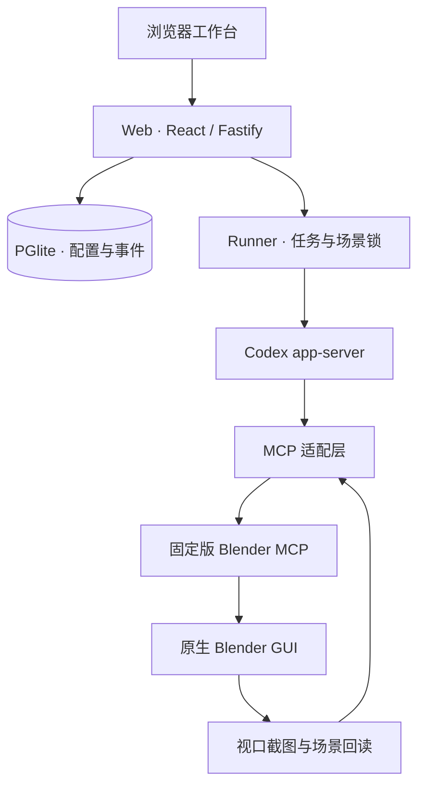

# Blender Pilot

在浏览器里打开真正的 Blender，用右侧对话栏完成场景创作。

Blender Pilot 是面向个人自托管的 Blender 工作台：原生 Blender 桌面、可收起的 AI sidebar、资源库、快照恢复和执行控制台。采用 **Codex CLI app-server + Blender MCP**，不自研 agent 推理循环。前后端使用 TypeScript，Blender 插件与场景脚本使用 Python。

> 当前为 0.1.0 首版，面向 Linux x86_64、单用户、多项目独立 Blender 实例。模型需要支持 **Responses API、流式响应、工具调用和图片输入**。只有 Chat Completions 的接口不能直接接入。



**验收状态：** 已使用真实 `gpt-5.6-luna` 接口通过「参考图 → Codex → Blender MCP → 场景修改 → 自动截图 → 视觉检查」验收，并通过续聊、取消、取消后继续和浏览器对话测试。新增多项目与素材组合链路已通过两个真实 Blender 实例、原生 Codex 协议及浏览器测试；本轮未重跑付费模型推理。Docker 镜像的整机启动仍未完成验证。详见 [验证记录](docs/validation.md)。

## 快速部署

服务器需要 Docker Engine 与 Docker Compose v2，至少预留 8 GB 内存、15 GB 可用磁盘；实际场景、贴图、快照和渲染需要更多资源。初次构建会下载 Blender 与运行依赖。多项目同时打开会增加内存占用，按场景大小规划资源；`.env` 的 `PILOT_MAX_STUDIOS` 默认 3，内存紧张时先设为 1。

```bash
git clone https://github.com/shiluyuan/blender-pilot.git
cd blender-pilot
./scripts/setup.sh
docker compose up -d --build
docker compose ps
```

`setup.sh` 生成 `.env` 并打印工作台访问密码，不会覆盖已有配置。默认仅监听服务器的 `127.0.0.1:8090`。

在自己的电脑连接远程 Linux 服务器：

```bash
ssh -L 8090:127.0.0.1:8090 your-user@your-server
```

打开 **http://localhost:8090**，使用部署密码登录，然后进入左侧 **设置**：

| 配置     | 填写内容                                                                                                |
| -------- | ------------------------------------------------------------------------------------------------------- |
| Base URL | 服务商 API 根地址，例如 `https://your-provider.example/v1`；保留服务商要求的路径，不要追加 `/responses` |
| API Key  | 服务商提供的密钥，支持任意前缀                                                                          |
| 模型     | 服务商实际支持的准确模型 ID                                                                             |
| 推理强度 | low / medium / high                                                                                     |

保存后点击「测试连接」。连接测试只验证 Responses 流式接口；图片和工具能力需要通过工作台中的真实任务验证。密钥在服务器端加密保存，不返回浏览器、不写进浏览器存储。

首次使用：创建项目 → 上传场景/人物参考图 → 在资源库点「引用」 → 描述要做的修改。可以先试：

> 保留默认场景，给立方体设置绿色材质，把它沿 Z 轴向上移动 1 米，截图检查结果。

AI 会读取场景、通过 MCP 执行 bpy 脚本，并收到实际截图。你可以展开工具卡查看脚本、回读结果和操作前后图片。

## 已实现

- **独立项目空间**：项目标签页、独立 Blender 进程和 Codex 会话、各自的草稿与引用；A 执行时可以在 B 创作。关闭项目会保存并释放实例，重新打开恢复场景。
- **原生视口**：服务器 Blender GUI 通过鉴权后的 WebSocket 显示在中央，可直接键鼠操作。对话侧栏可收起、调宽，`Alt+J` 切换；深色/浅色主题。
- **原生 Codex 会话**：app-server 协议、流式消息、工具卡、会话续接、取消任务、浏览器刷新后事件补发、请求幂等。
- **视觉闭环**：操作前截图，每次场景写入后截图与对象回读，结束时要求模型提交当前截图的检查结论。截图以图片内容传给模型；失败或缺少视觉报告不会显示为验证成功。
- **可复用素材库**：人物、物品、场景、材质分类；保存 Blender 选中对象或场景集合，附真实视图预览；跨项目独立副本导入、标签搜索、收藏、下载与对话查找/保存/复用。多选素材批量引用或导入，外部模型可直接上传到全局库，记录来源、作者和许可；组合保存保留源素材 ID。详见 [素材库指南](docs/asset-library.md)。
- **资源库**：批量拖入/粘贴图片、分块断点续传、内容去重、缩略图、搜索、类型过滤、标签和分组信息、分页。引用与导入是两项独立操作。
- **场景与文件**：项目切换、保存、操作前后快照、恢复前备份、GLB/内嵌 glTF/`.blend` 下载。支持导入 GLB、内嵌 glTF、FBX、OBJ、`.blend` 对象和图片数据块。
- **控制台**：执行服务、Blender、存储和固定版本信息，真实工具事件与错误。
- **持久化**：PGlite 数据库、项目资产、运行事件、原生 Codex 会话与加密配置都在一个 Docker volume 中。

图片引用不会自动变成 3D 模型。模型会根据视觉参考和你的描述编写 Blender 操作；复杂人物、精确拓扑和高质量材质仍依赖模型能力与进一步迭代。

## 部署结构



只有 Web 的 8090 端口对外映射；Runner、MCP 和 VNC 不发布到宿主机。执行环境使用普通 uid 1000 运行，不需要 privileged 容器或 Docker socket。

## 开发与检查

```bash
npm ci
npm run check
```

开发网页：先运行 Docker 中的 studio，或本机安装 Blender/MCP 桌面依赖，然后在同一台机器分别运行：

```bash
# 两个 Node 进程需要相同 PILOT_DATA 和 PILOT_INTERNAL_TOKEN
export PILOT_DATA="$PWD/.data/dev"
export PILOT_PASSWORD='your-development-password'
export PILOT_INTERNAL_TOKEN='your-development-token-at-least-32-chars'
export PILOT_RUNNER_URL='http://127.0.0.1:8091'
npm run runner
npm run dev
npm run web
```

Vite 默认地址 http://localhost:5173，代理 `/api` 和 `/desktop`。本机 Runner 需要 Xvfb、openbox、x11vnc、Blender 和 MCP，并设置 `PILOT_BOOTSTRAP_PATH="$PWD/deploy/bootstrap.py"` 与 `PILOT_ADDON_PATH`。默认按项目自动启动桌面，无需手工预开 Blender；完整原生集成验证见 [测试文档](docs/validation.md)。

## 文档

- [部署、HTTPS、备份与升级](docs/deployment.md)
- [架构、维护边界与数据约定](docs/architecture.md)
- [功能边界与使用说明](docs/product.md)
- [项目工作区与界面参考依据](docs/workspaces.md)
- [素材库：人物、物品与场景复用](docs/asset-library.md)
- [测试方法与实际验证记录](docs/validation.md)
- [第三方项目与许可证说明](THIRD_PARTY_NOTICES.md)

## 当前边界

第一版只接入 Codex；Claude adapter 暂未实现。每个项目独占一个 Blender 实例，同一项目的场景操作串行，不同项目可并行。AI 运行时对应项目的网页视口切为只读。多人实时协作、浏览器端 3D 引擎和游戏编程不在本版范围内。

此工具执行模型生成的 Python，适合自己使用的可信工作台。容器是进程边界，项目路径校验不是 Python 沙箱；不要把它当作开放给陌生用户的多租户服务。部署到公网时使用 HTTPS 与访问密码。

界面密度与工作区组织参考 [VoiceStudio](https://github.com/debpalash/VoiceStudio)，界面代码为本项目独立实现。
