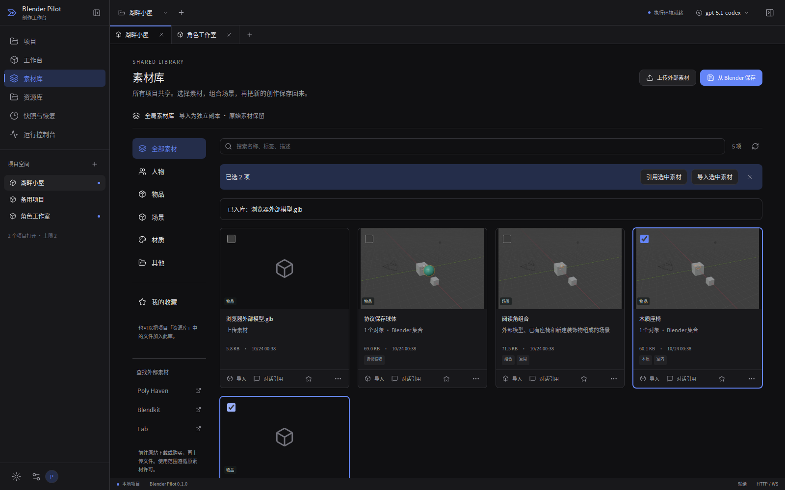

# 可复用素材库

素材库保存可跨项目使用的内容；原有「资源库」仍保存当前项目上传的参考图、模型和纹理。两者都在部署的数据卷内，不需要额外数据库、对象存储或云服务。

## 制作一次，在不同项目使用

1. 在 Blender 对象模式选中人物、物品或一组对象。
2. 打开左侧「素材库」→「从 Blender 保存」。填写名称、分类、标签和描述。
3. 保存范围选择「当前选中对象」，或「当前场景全部对象」。空选择会明确报错，不会悄悄保存整个场景。
4. 切换到另一个项目，在素材卡片点「导入」。Blender 集合以独立副本追加，不清空当前场景。
5. 用对话调整新副本的位置、尺寸和材质。原素材文件保持不变；再次导入仍使用原始版本。

「资源库」中的上传文件可以点「入库」复制到全局素材库，然后编辑分类。此操作复制原文件和已有缩略图，不将参考图片自动转换为三维模型，也不会自动补齐上传模型缺失的外部文件。

## 外部素材 → 组合 → 再入库

1. 从原站下载允许使用的素材。在「素材库」点「上传外部素材」，可一次选择多个文件，不必先创建项目。
2. 选择分类，填写来源页面、作者、许可说明。推荐含贴图的 GLB 或已打包依赖的 `.blend`。
3. 勾选几个素材，点「引用选中素材」，再告诉当前项目助手如何摆放与改造；或者「导入选中素材」直接追加。批量导入逐项显示成功/失败，不自动重试不确定的场景写入。
4. 创建新的对象或修改组合后，用「从 Blender 保存」保存明确选择的对象。组合条目记录直接使用的 `sourceAssetIds`，原素材保留自己的来源与许可记录；这不是自动许可证合规判断。
5. 切换另一个项目，把组合素材导入，再独立编辑。

原站入口包括 Poly Haven、Blendkit 与 Fab。这些是外链导航，没有连接商店账号、代购或自动抓取功能。多文件 ZIP 包、OBJ/MTL/贴图目录不会自动解包和重写相对路径；先用 Blender 整理并打包，或转换为含资源 GLB 后上传。全局库上传采用与项目资源相同的格式与大小校验，内嵌 glTF 才可直接上传。

引用最多 12 项。引用不自动导入；模型能根据准确 ID 读取素材信息与预览，再调用导入工具。参考图也能入库，但图片不会因此变成三维模型。

## 分类、查找与整理

| 分类 | 适合保存                         |
| ---- | -------------------------------- |
| 人物 | 角色对象、骨架及已绑定网格       |
| 物品 | 家具、道具、建筑构件、植物       |
| 场景 | 房间、街区等对象组合             |
| 材质 | 带材质的样例对象、上传的纹理文件 |
| 其他 | 参考图或尚未整理的资源           |

支持按名称、描述、标签搜索，分类过滤、收藏、分页和元数据编辑。分类是素材管理信息，不会改变 Blender 数据类型。标签支持中文逗号或英文逗号。素材卡片提供真实预览、文件大小、创建时间和下载入口。

当前预览采用保存时 Blender 视图，可能包含周围对象；不是离线单物体棚拍渲染。保存前调整视图能得到更合适的预览。上传模型暂时使用模型图标，上传图片使用缩略图。

## 用对话保存和复用

示例：

> 把选中的椅子保存到物品素材库，名称叫「橡木餐椅」，标签是木质、餐厅。

> 搜索素材库里的木质椅子，看看预览，选一个导入当前场景，放在桌子的右侧。

> 把当前房间全部对象保存为场景素材，名称叫「小型咖啡店」。

素材卡片的「对话引用」把名称和准确 ID 加入输入框上方的引用列表，供你补充用途后发送，不会立即消耗模型调用。模型可通过以下工具完成闭环：

| 工具                   | 行为                                                 |
| ---------------------- | ---------------------------------------------------- |
| `search_library`       | 按名称、描述、标签、分类分页查询                     |
| `get_library_asset`    | 返回元数据和实际预览图像，方便模型查看参考           |
| `save_library_asset`   | 保存当前选择、明确命名对象或整个场景的对象集合       |
| `import_library_asset` | 向当前项目追加素材，回读实际对象名、变化回执与新截图 |

素材预览不是当前场景截图，不能代替 `report_verification` 的当前 captureId。导入后仍走原有自动截图与视觉验证流程。

## 保存什么，哪些仍有边界

- Blender 素材采用 `.blend` Collection，使用 Blender 原生 `bpy.data.libraries.write/load`，没有新增 Blender 插件或改动上游 MCP。
- 选择保存会扩展父子层级，以及常见 modifier 的 `object`、constraint 的 `target` 依赖。材质、网格、动作等由 Blender 保存其间接引用。复杂 Geometry Nodes、驱动器、跨场景引用仍需逐个项目验证；不能保证任意生产资产的依赖闭包。
- 保存前调用 `pack_all`，可打包的图片等数据随文件保存，也会改变当前项目中这些资源的打包状态。缺失文件、视频、模拟缓存或外部链接库不能承诺完整自包含。交付前仍应检查。
- 生成素材时不会改名、删除或移动源对象。通过真实 Blender 测试验证了父子层级、材质、变换、贴图自包含和重复导入的数据独立性。
- 「场景」保存的是对象集合，导入是合并；不替换项目世界、渲染配置、场景时间线设置。需要完整恢复请用快照或 `.blend` 导出。
- 「材质」目前是整理分类，不是独立 shader 预设应用系统。
- 当前没有链接实例、自动版本升级、批量删除/回收站、自动去重生成素材、自定义分类树或多人权限。重复保存创建新素材，不覆盖旧文件。
- 全局列表扫描轻量 JSON 元数据；图片和模型按需加载，默认每页 60 项。没有对数万条素材做性能验收。

## 持久化和维护

每个素材放在 `/data/library/<id>/`：`asset.blend` 或上传原格式、可选 `preview.jpg`、`asset.json`。模型文件和预览完成后才原子写入元数据，未完成的条目不会显示。正常失败清理本次目录；进程突然终止可能留下不可见临时目录，当前不自动清理。

Runner 负责生成新的 Blender 素材；网关负责上传资源入库与元数据编辑。新条目 UUID 独立，内容文件不覆盖；编辑经网关串行处理并原子替换 JSON。PGlite 仍只由 Web 进程打开。无需迁移旧项目，备份时包含整个 volume 即可。

所有文件下载和列表需要登录；文件访问校验素材目录和符号链接，不能通过客户端传入任意绝对路径。手动保存/导入和对话修改共用原有场景队列与任务锁。
