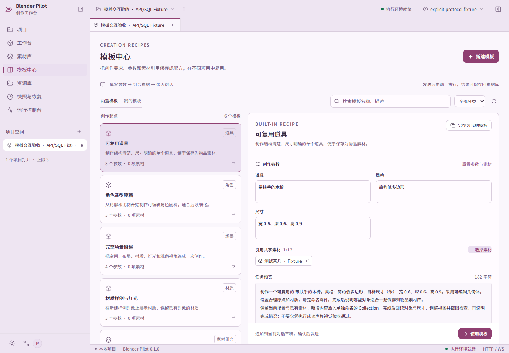
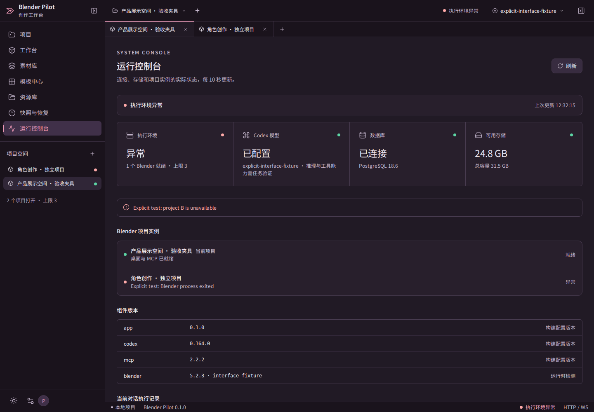
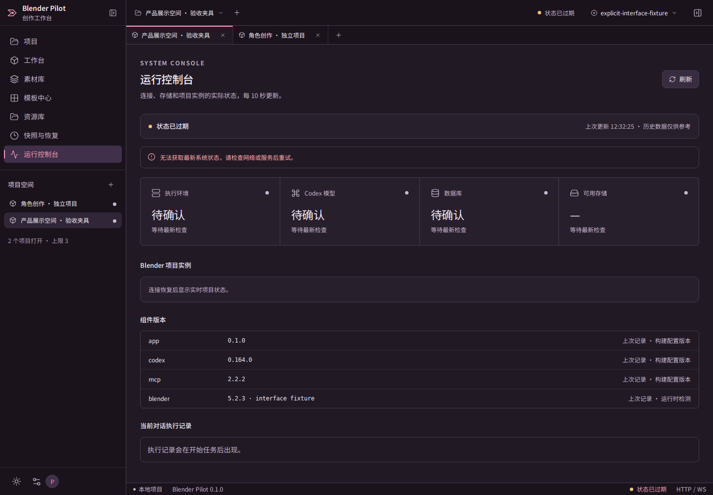
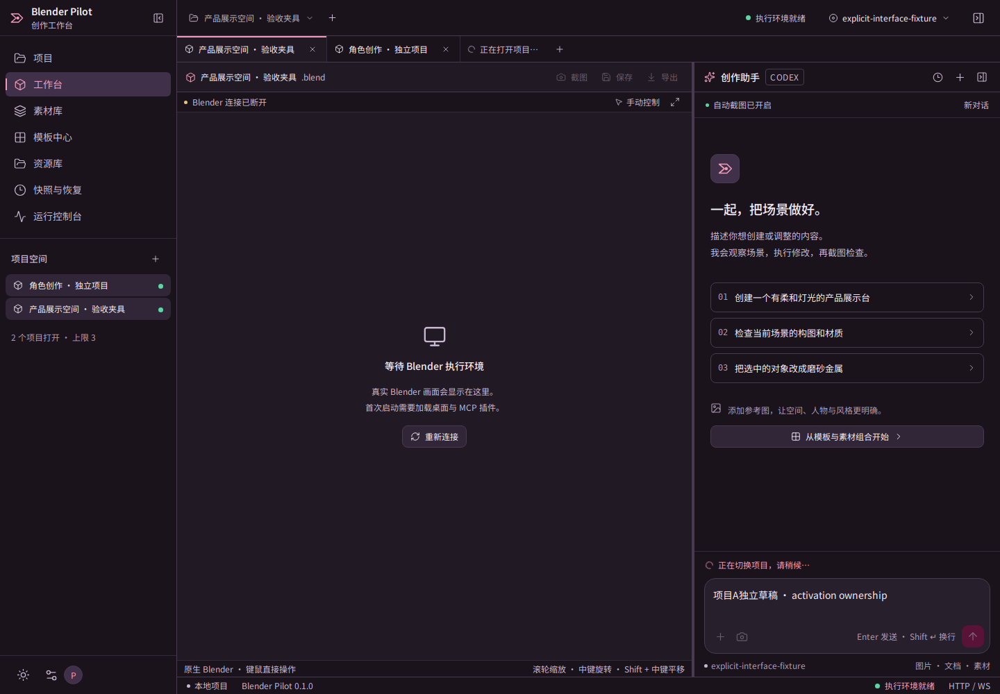

# 界面一致性与系统状态验收

验收日期：2026-10-24（北京时间）。本轮修复界面和状态显示，并重新检查主要操作流程。正式生产发布的 Docker / 原生 PostgreSQL 及最终真实模型浏览器验收缺口仍见 [上线前验收](release-readiness.md)。本轮没有向外部模型接口发送数据。

## 视觉依据

实际核对 VoiceStudio 提交 [`80a01e5`](https://github.com/debpalash/VoiceStudio/tree/80a01e595b5ae060e47fdeaa128d21f3a38de0df) 的 README `voice-cloning.png` 与主题、导航、标题栏和状态栏源码。以截图的紫黑画布、深色导航、洋红操作按钮和圆角输入区统一工作台、素材库、模板、设置和控制台。浅色采用该项目 Classic 的配套表面色。

该项目支持多套主题；截图与其默认主题、最新主题源码存在差异。这里选择实际截图的可见风格，并保留 Blender Pilot 的中央原生 Blender、右侧可收起助手和多项目结构，不宣称完整克隆。完整来源与取舍见 [工作区参考](workspaces.md)。

## 按流程验收

| 步骤                | 检查与结果                                                                                                                 | 证据范围                                                              |
| ------------------- | -------------------------------------------------------------------------------------------------------------------------- | --------------------------------------------------------------------- |
| 1. 登录与项目上下文 | 首次状态等待、模型未配置、项目切换和切换失败恢复均有明确反馈；切换过程中暂时锁定输入、附件和场景操作，避免输入落入旧项目。 | 真实 Web / SQL 与受控 Runner 浏览器测试；历史和回执恢复另有完整回归。 |
| 2. Blender 与对话   | 项目保持独立场景、对话、草稿和素材引用；可收起导航、收起和调整助手。                                                       | 真实双 Blender、VNC、MCP 和 Codex 原生协议；模型响应明确为测试夹具。  |
| 3. 素材与模板       | 分类、引用、组合、模板应用和跨项目复用；外部 GLB 的纹理与副本独立性。                                                      | 模板浏览器回归与真实 Blender 文件/对象回读。                          |
| 4. 系统状态         | 等待、健康、配置缺失、Runner 不可达/异常、单项目失败、磁盘未知、配置读取失败、畸形响应、断线与恢复。                       | 真实健康 API 和故障注入；明确区分结构化测试响应与真实 Blender 故障。  |
| 5. 主题与尺寸       | 五个主要页面深浅主题；1440px、1280px 和 1024px；修复窄窗口底部提示换行裁切。                                               | 本轮截图逐张复核；加载中的素材库截图被拒绝并重新捕获。                |
| 6. 后端与恢复       | 登录撤销、事件续传、取消、回执不确定、挂起项目隔离、文件丢失、进程故障与服务重启。                                         | 应用/SQL/协议用例、部署参数用例与本轮原生场景回归。                   |

## 关键修复

- 状态按 10 秒轮询，可手动刷新；显示最近成功检查的时间。请求失败时立即标记过期，组件显示待确认，恢复后重新读取。
- 新登录有独立轮询代际；旧请求无法重新覆盖新登录。异步项目初始化和项目切换也有失效检查。
- 数据库、存储、模型配置与 Runner 独立采集。单项读取失败不丢弃其余结果；完整数据库故障阻断认证时，界面显示检查失败，不把它当作退出登录。
- Runner 的 HTTP 503 保留实例和任务信息；可达性、运行健康与每项目 Blender 状态分别表达。实例关闭中不会被误显示为启动中。
- 严格校验 Runner 状态结构；畸形数组或字段转换为明确异常，避免后端 500 和前端崩溃。
- 修复桌面启动失败被后续异步回调覆盖为“就绪”的竞态。托管桌面拒绝占用中的端口，在场景加载/保存前核对本次启动标识与 Blender PID，并在每个阶段检查子进程和关闭状态。Runner 单进程崩溃留下的桌面不会被当作新的实例接管。
- 模型仅标记“已配置”，不据此宣称推理、视觉或工具能力通过。Codex/MCP 固定版本标注为构建配置，Blender 运行时版本另行标注。
- 配色、字体、按钮、卡片与输入区共用样式变量；状态色独立于品牌色。抽样文字和主按钮对比度达到 4.5:1，不能据此宣称完整无障碍合规。

## 截图

下列均为本轮实际运行截图。工作区中的几何体为合成和公开测试素材；模型响应由受控协议夹具提供。控制台故障图使用明确标识的故障夹具。










已接受的 20 张五页面深浅主题与尺寸截图保存在 [完整界面截图](screenshots/interface/)，对应 [视觉复核记录](validation/interface-visual-review-2026-10-24.json)。

## 最终结果

- 79 项 Node 应用/协议/SQL/故障检查、11 项 Python 部署检查、类型检查及生产构建通过。
- 60 组浏览器检查通过：聊天 15、模板 20、旅程 9、界面与状态 16；没有未捕获的浏览器错误。
- 双 Blender 12 组重测通过，含启动身份核对、遗留端口拒绝、明确清理测试自有进程后的恢复。不能枚举旧 Runner 子进程时，不再依赖旧桌面继续通过验收。
- 单 Blender 的原生 MCP、快照恢复、GLB/glTF/blend 导出、素材复用、Codex 续接/取消与浏览器下载链路通过；图像输入 19 次，模型响应均来自本地协议夹具。

截图复核发现早期“就绪但附带 Xvfb 退出错误”的原生结果，已取消其验收资格并修复；本报告只使用补修后新目录的重测与截图。旧结果不计入本次通过数量。

## 复现与证据

```bash
npm run check
npm run verify:chat
npm run verify:templates
npm run verify:journeys
npm run verify:interface
npm run verify:workspaces
```

浏览器命令需要先执行 `npm run build`。测试数据库必须可丢弃；无法运行原生 PostgreSQL 的受限环境需显式使用 `PILOT_TEST_POSTGRES_MODE=wasm-wire`。该模式运行 PostgreSQL WASM，通过 TCP 和 pg 驱动验证 SQL/协议，不等同于原生 PostgreSQL 进程及 Docker 部署。

原生测试依赖和参数见 [验收记录](validation.md)。测试证据使用新建目录，失败或中断尝试不记作通过；脚本不调用付费模型，也不修改正常部署实例。完整机器记录与当前通过数量见 [本轮汇总](validation/interface-summary-2026-10-24.json)。
