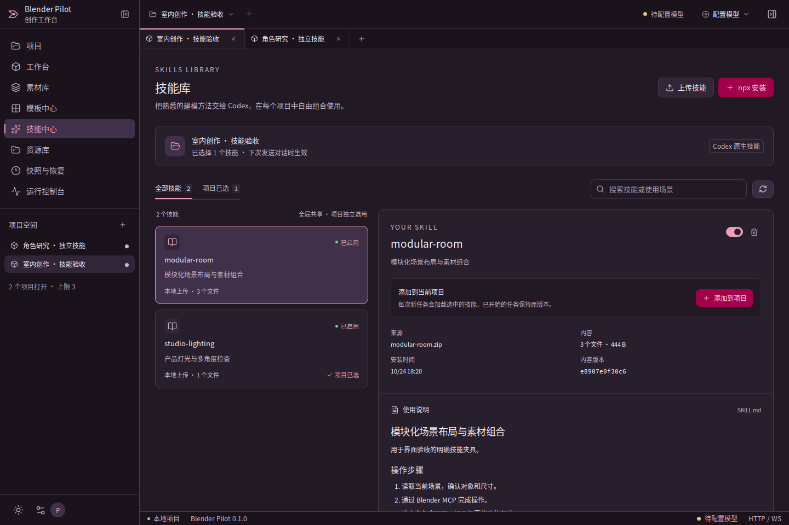
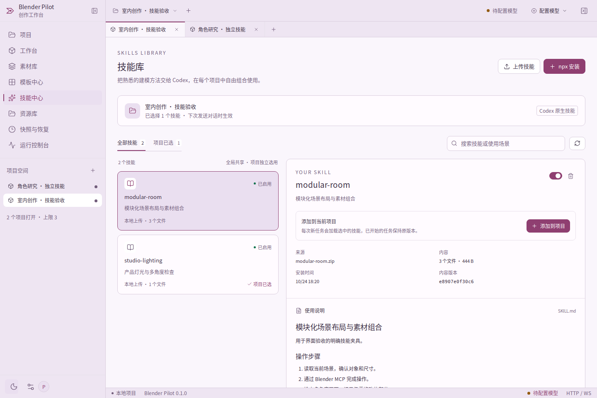
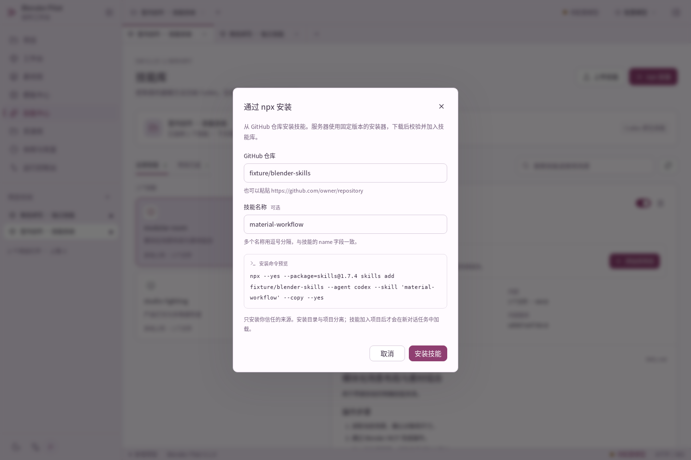
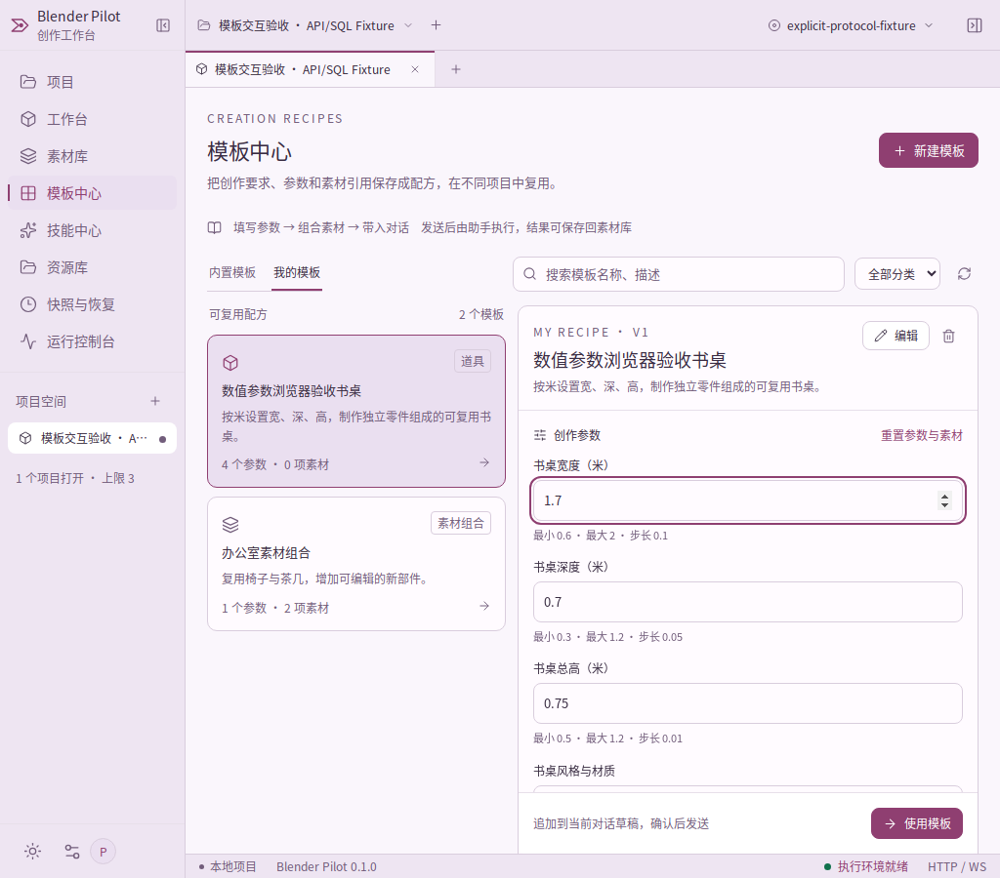
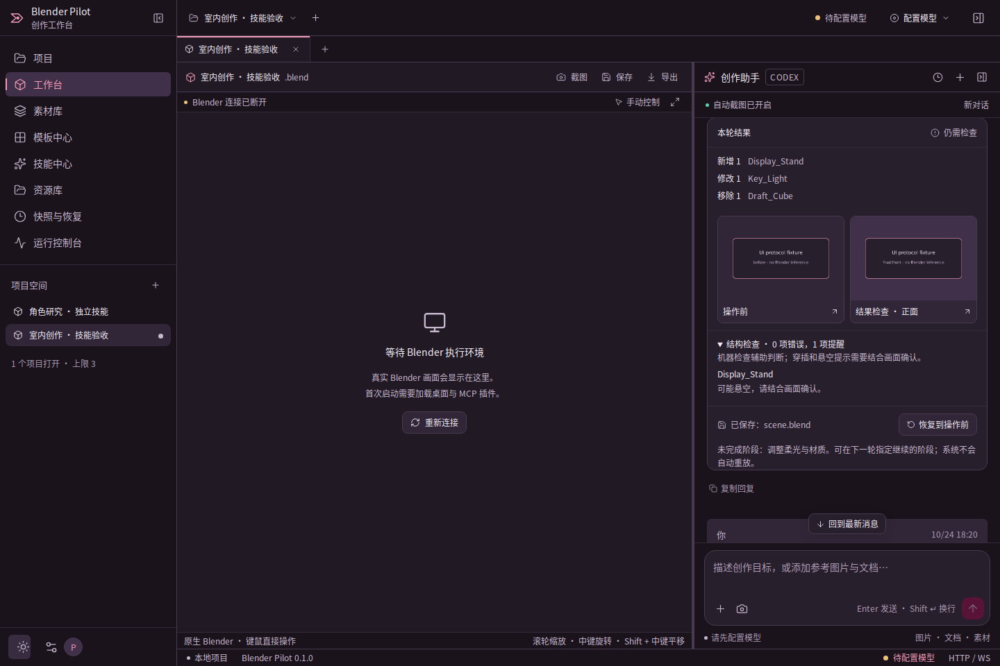
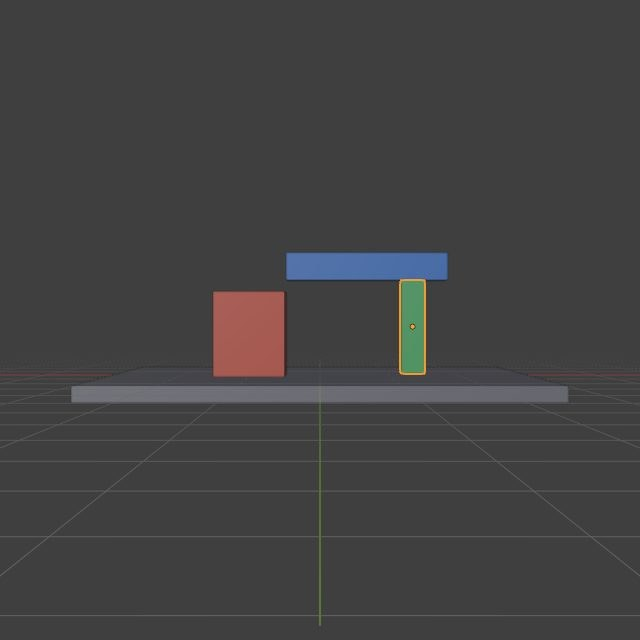
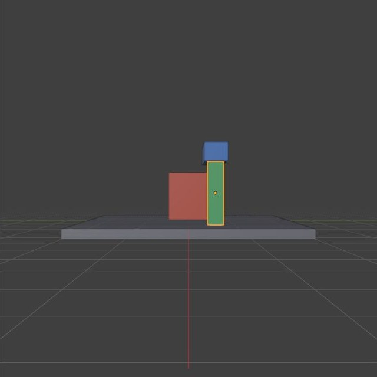
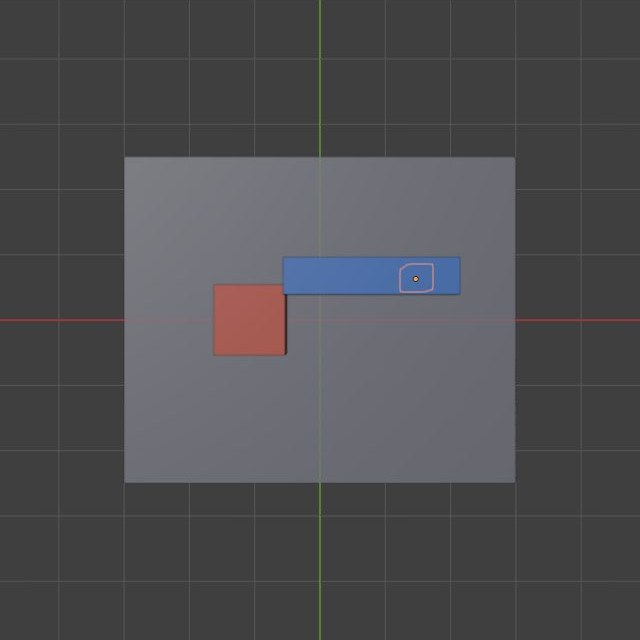

# 技能与创作质量验收

> 历史验收记录：本页截图来自之前的紫色主题，保留以便追溯。当前配色与截图以 [素材与配色验收](asset-formats-and-theme.md) 和 README 为准。

本轮在已验收的 VoiceStudio 风格工作台上增加技能中心、创作阶段、多角度质量检查、参数化模板和结果摘要。数据库继续使用 PostgreSQL，内容文件保存在本地；没有另起一套 Agent 内核。

## 已实现的用户流程

| 流程       | 行为与证据                                                                                           |
| ---------- | ---------------------------------------------------------------------------------------------------- |
| 上传技能   | SKILL.md／ZIP → 校验 → PostgreSQL 目录 → 本地内容 → 项目选用；重复名称不会覆盖                       |
| npx 安装   | 实际安装公开仓库中的 vercel-composition-patterns，13 个文件、49,809 字节；固定 skills@1.7.4          |
| 对话加载   | 上传技能 → 固定本轮副本与哈希 → Codex 原生技能输入 → MCP 读取资源 → Blender 操作；完整原生链路已验证 |
| 创作阶段   | 最多八步，完成阶段读取实际对象并创建恢复点；事件持久化，下一轮可以指定继续；重启不重放修改           |
| 质量检查   | 原子获取三个方向的真实画面，再检查结构；版本过期、结构错误或未完成阶段不能通过                       |
| 参数化复用 | 保留原有六个模板，增加书桌、置物架、办公室；数值有单位、边界和步长，前后端共用校验                   |
| 结果与恢复 | 显示对象变化、画面、保存状态和恢复点；仅有操作前截图的取消任务不冒充操作后画面                       |
| 系统状态   | 对话显示准备、等待模型、操作 Blender、检查和保存；沿用逐组件健康、断线与恢复信息                     |

实际 npx 测试使用通用公开技能验证安装兼容性，不代表该技能是 Blender 制作教程。模型能力和具体技能的艺术效果仍需独立验证。

## 界面截图

下列是实际运行的浏览器界面。技能上传、目录、文件和项目选择使用真实 API 与数据库协议；浏览器故障和结果卡使用明确的测试夹具。结果卡上的占位图也标明是 UI 测试，不能当作真实模型作品。

这组三视角图来自实际 Blender 5.2.3 与 MCP，使用合成测试几何体；没有模型推理参与。

| 正面                                   | 右侧                                   | 俯视                                 |
| -------------------------------------- | -------------------------------------- | ------------------------------------ |
|  |  |  |

## 本轮修复的回归问题

- 上游技能安装器复制时会解引用符号链接。现在先检查 Git 树并仅检出普通文件；技能目录内的链接拒绝，目录外的元数据链接不交给安装器。
- 原始视口切换会触发 Blender 的宽泛变更计数。改为复用 MCP 原子多视角图集，验证视角说明并拆分真实图像，然后绑定当前结构报告；不是放宽过期检查。
- 检查通过后再更改阶段、场景或在保存期间编辑，原先可能显示成功。现在最终保存前后均复核，过期结论中断，部分成果仍可保存。
- 取消任务只有操作前图片时，不能把同一张图片重复显示成操作后。后端过滤，前端也根据实际截图类型标注。
- 旧项目使用合法的非 UUID 编号时，技能集成不能阻断原有聊天；已保留原有 ID 合约并回归测试。
- 技能和项目异步请求、目录超时、停用后的选择、卸载清理警告都有真实状态显示。测试机中文字体也按实际渲染验证，缺字截图没有进入交付记录。

## 测试记录与范围

最终数量和源文件校验值见 [机器摘要](validation/skills-quality-summary-2026-10-24.json)。对应报告分别记录实际环境，不能把模型协议夹具算作真实推理，或把 WASM 数据库算作原生 PostgreSQL。

| 套件                                    | 报告                                                                                                                                                            |
| --------------------------------------- | --------------------------------------------------------------------------------------------------------------------------------------------------------------- |
| 技能、任务阶段与结果界面                | [浏览器报告](validation/skills-browser-2026-10-24.json)、[截图审阅](validation/skills-visual-review-2026-10-24.json)                                            |
| 模板与数值约束                          | [模板报告](validation/skills-templates-2026-10-24.json)                                                                                                         |
| 公开仓库实际 npx 安装                   | [npx 报告](validation/skills-real-npx-2026-10-24.json)                                                                                                          |
| 真实 Blender 多角度检查                 | [质量报告](validation/quality-native-2026-10-24.json)                                                                                                           |
| 上传技能到 Codex／MCP／Blender 完整链路 | [原生链路报告](validation/skills-native-2026-10-24.json)                                                                                                        |
| 双 Blender 项目、故障与恢复             | [双项目报告](validation/skills-workspaces-2026-10-24.json)                                                                                                      |
| 原有聊天、状态与异常流程                | [聊天](validation/skills-chat-2026-10-24.json)、[使用流程](validation/skills-journeys-2026-10-24.json)、[界面状态](validation/skills-interface-2026-10-24.json) |
| 真实部署入口                            | [当前云端受阻报告](validation/production-host-blocked-2026-10-24.json)                                                                                          |

原生单项目和双项目报告先于最后的取消截图显示修复；该局部修复随后通过任务生命周期单测和浏览器补验，不声称再次运行了原生整套测试。失败、缺字截图和较弱的早期报告均未计入最终通过数量。

## 仍未关闭的上线条件

当前支持受控试运行。正式上线还需要目标服务器上的 Docker 首次构建、原生 PostgreSQL 和容器重启持久化实测。已提供可执行的 [目标服务器验收命令](deployment-acceptance.md)；云端没有可用 Docker daemon，因此报告明确为 blocked。

本轮没有调用外部真实模型，所有 Codex 流程使用本地 Responses 协议夹具。此前真实模型核心与模板子套件的结果保留为历史记录；新的技能与多视角行为仍需在已配置的真实模型上补验。之前自动审批阻止了向具体模型接口发送场景截图及对象信息，这项发送范围尚待用户明确确认。

此外，本轮没有完成大型场景性能、GPU 压力、最终渲染质量、精确网格相交或完整拓扑验收。结构候选提示和三视角图片提高可检查性，不等于自动保证艺术品质。
